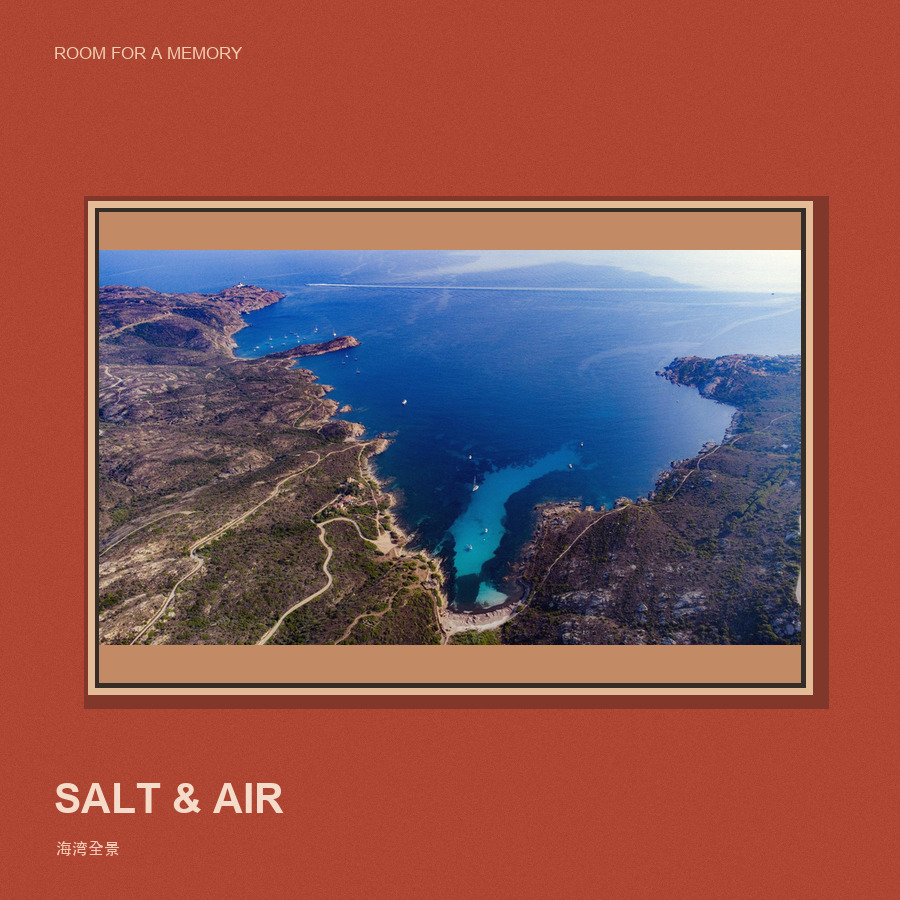
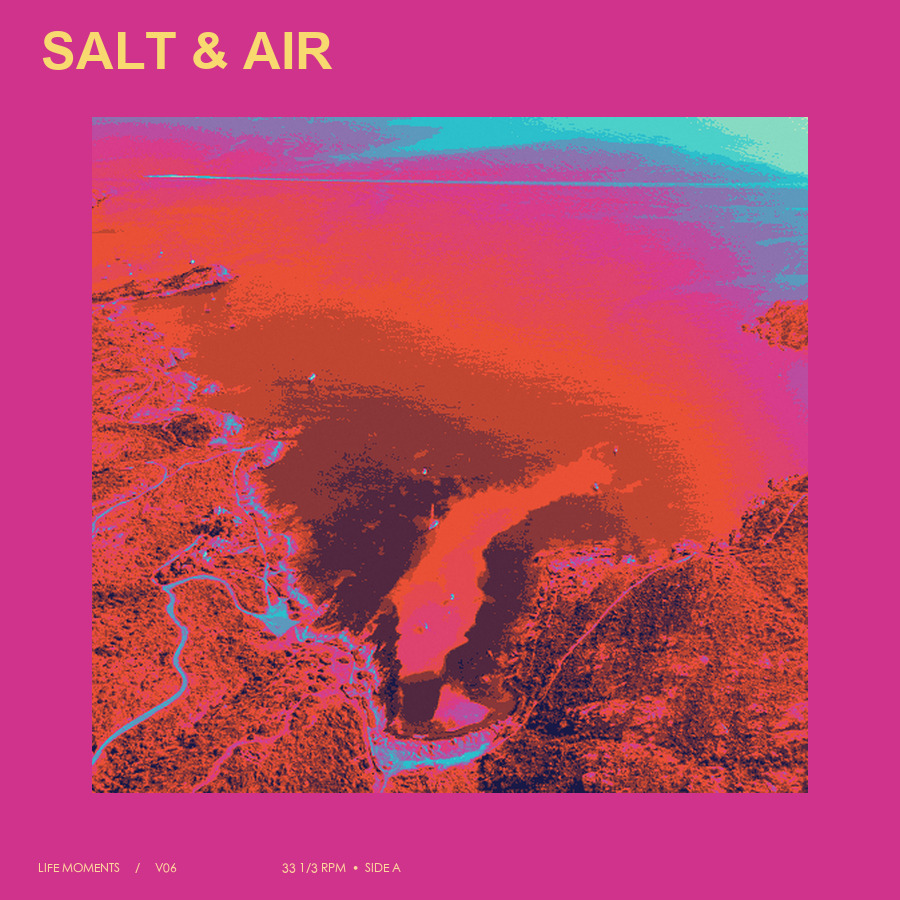
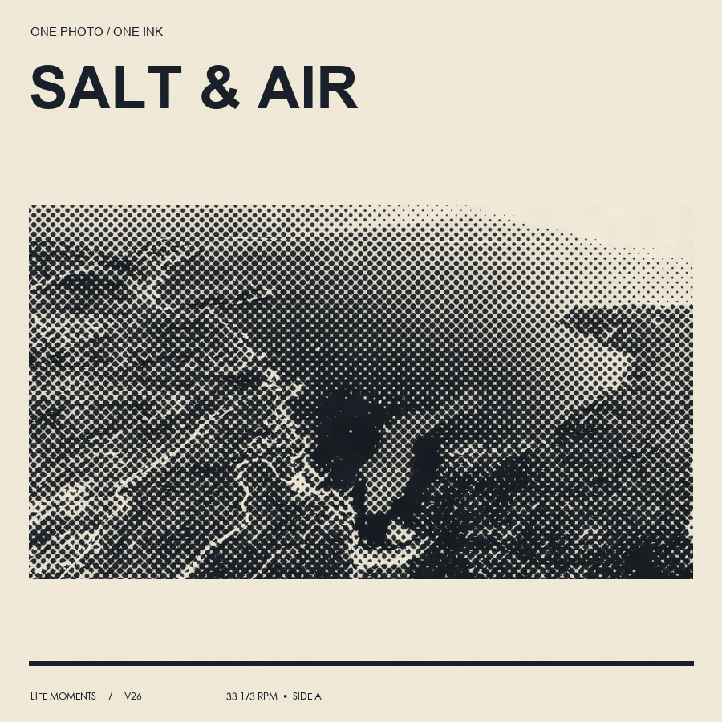

# Visual Direction Moodboard

[中文](README.md) | **English**

## Less AI sameness. More design character.

AI designs starting to look alike? Build a distinct visual direction with real design references and your own taste.

This **moodboard skill** helps your AI agent find real work, show a reference gallery, discuss your picks, and refine a direction. Use it for brand identity, UI design, album covers, and creative research.

**Keywords → real design references → your picks and feedback → deeper research or small trials → a moodboard with clear design decisions.**

[Install](#install) · [See it in action](#real-case-from-album-references-to-photo-trials) · [Contribute](#contribute)

## Start with one prompt

After installing, tell your agent what you are working on:

```text
Use visual-direction-moodboard. My coffee brand should feel warm, rough,
and handmade, without the generic AI look. Find real design references
and let me browse and pick images. Discuss my choices before making a moodboard.
Respond in English.
```

Start with keywords, images you already like, or a specific design problem. In Codex, you can also invoke `$visual-direction-moodboard` directly. The Skill instructions are currently in Chinese; this README provides an English guide.

## How it works

| You | Your agent | What you get |
| --- | --- | --- |
| Share a project, keywords, or references | Find real work and show different interpretations | A candidate gallery with IDs, keywords, and source links |
| Pick images or say what feels wrong | Discuss typography, color, texture, and cropping; refine the search | Your choices and discussion, with other candidates still available |
| Ask for small trials when useful | Compare approaches on your material, then check different inputs | Original-to-trial comparisons and notes on where each approach works |
| Ask to synthesize once the direction is clearer | Identify the design decisions worth keeping | A moodboard or reference page, with optional visual rules for handoff |

You do not need a perfect explanation of your taste. “I like the type-to-image ratio in I012, but not the colors” is enough to continue. Liking a reference does not mean accepting every part of it.

HTML galleries should save and export selections. The agent must actually read your feedback; if it cannot access the saved choices, paste the export into the conversation.

## Real case: from album references to photo trials

One project collected **37 design projects and 68 reference images**. The user liked **19 references**, then asked whether those visual approaches could work across different photos. That question led to practical trials.

These are actual exploratory outputs using the same coastal photo:

| Photo window and space | Electric color separation | Coarse single-ink halftone |
| --- | --- | --- |
|  |  |  |

The comparison changes both image treatment and layout. It helps discuss complete expressions; these are not approved final brand designs. Photo: Tom / Pexels. [Image credits and licenses](examples/ASSET-CREDITS.md) (Chinese).

The first trial round explored 19 templates across 10 inputs. Later feedback led to changes in halftones, full-image treatments, and color variants. This was the scope requested for that project; a few focused trials are usually enough to start a discussion. The halftone shown above came from a later round.

The useful output was a record of what the user liked, what worked on their material, and what needed another pass. **[Read the full illustrated case study](examples/photo-to-cover.md)** (Chinese), including the same method applied to different photos.

<details>
<summary>Teaching example: a coffee brand, from words to a direction</summary>

This is an illustrative scenario, not a completed client case. IDs and feedback are examples.

1. “Warm, rough, handmade” → explore paper, print, typography, and spaces.
2. “I like I012’s layout, but not the brown palette” → separate layout preferences from color preferences and search again.
3. “Try two type-to-image relationships with the same photo” → keep the photo and copy consistent while comparing layouts.
4. “Keep large type and rough paper, with fresher colors” → synthesize the supported decisions and leave color open for further trials.

</details>

## Install

Download a ZIP from [Releases](https://github.com/buttonsprite/visual-direction-moodboard/releases/tag/v0.1.0).

- **Codex / standard Skill:** use `visual-direction-moodboard-v0.1.0.zip`. Extract the `visual-direction-moodboard` folder into your Skills directory. Codex defaults to `~/.codex/skills/`, or `skills/` under your configured `CODEX_HOME`. The folder should directly contain `SKILL.md`, `references/`, and `agents/`. Back up any existing version before replacing it, then reload skills.
- **WorkBuddy:** use `visual-direction-moodboard-workbuddy-v0.1.0.zip` for ZIP import or submission to the open platform. Its metadata follows the [official specification](https://open.workbuddy.cn/docs/skill). Parsing, runtime compatibility, and marketplace status must be verified in WorkBuddy.

## What is included

This is a workflow Skill for an AI agent. Galleries and trials are created for each project; the gallery app and image-processing engine used in the example are not bundled.

Your agent needs search, browsing, and image-viewing tools. HTML galleries or design trials also need the relevant file and image tools. No particular model or paid service is required by the Skill. v0.1.0 is a public preview; behavior across agents and WorkBuddy still needs practical testing. A moodboard supports visual direction; a complete brand system needs further design work.

## Contribute

Designers and non-developers are welcome too:

- [Open an issue](https://github.com/buttonsprite/visual-direction-moodboard/issues) with your environment, request, actual result, and suggestions.
- [Submit a pull request](https://github.com/buttonsprite/visual-direction-moodboard/pulls): fork the repo, improve the workflow, docs, or platform support, and explain your changes and checks. Maintainers review contributions before merging into `main`.
- **Share a case study:** show the initial idea, image choices, feedback, and revisions. Label real results and teaching examples clearly; include image sources and licenses.

Discuss major workflow changes in an issue first. Keep candidates accessible, distinguish user choices from agent judgments, and let feedback guide further research. A public repository does not give everyone write access to its main branch.

## Docs and license

[Skill instructions](SKILL.md) · [Workflow](references/standard-workflow.md) · [Record templates](references/deliverable-templates.md) — currently in Chinese.

Skill documentation and configuration use the [MIT License](LICENSE.txt). Example photos and their derivatives retain their own [image licenses](examples/ASSET-CREDITS.md); they are not covered by MIT.

Explore: Moodboard · Visual Direction · Design References · Brand Identity · Art Direction · Design Research · AI Design · Agent Skills
