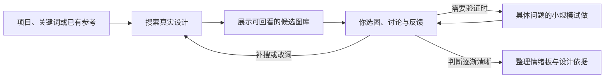

# 共创式视觉情绪板 · Visual Direction Moodboard

**和 AI 一起找图、看图，找到自己的视觉方向。**

已经有几个关键词，或者几张喜欢的设计，却还没想清楚具体怎么做？这个 Skill 会围绕你的想法搜集真实作品，整理成可以浏览、放大、查看来源的候选图库。

你可以选喜欢的图，也可以说“只喜欢这里的字体”“这个配色不对”。AI 会根据反馈继续找图，必要时制作少量试样，最后把逐渐明确的判断整理成情绪板。通过真实设计参考与多轮看图讨论，帮助你形成更具体的视觉判断。

**你会得到：**真实参考图库、选图与讨论记录、整理后的情绪板，以及按需制作的设计试样。

安装后，试着这样开始：

```text
使用 visual-direction-moodboard。我在做一个咖啡品牌，
有温暖、粗粝、手工的感觉。先帮我找真实设计，
让我看图讨论后再整理方向。
```

这是安装到 AI Agent 环境中使用的 Skill。找图、看图和讨论本身就是产出，你可以在有用的阶段停下来，也可以继续深化。

[下载与安装](#下载与安装) · [具体怎么用](#具体怎么用) · [真实案例](examples/photo-to-cover.md) · [更多提示词](#第一次可以这样说) · [参与贡献](#参与贡献)

## 一次探索怎样推进



你可以从任何已有进展开始：有关键词就直接搜，有参考就深入作品，有具体问题就研究局部方法。默认在候选图库阶段留出讨论机会；你也可以明确让 Agent 代选。

## 具体怎么用

| 这一步 | 你做什么 | Agent 做什么、你会看到什么 |
| --- | --- | --- |
| 1. 说明起点 | 给项目用途、已有感觉、喜欢或不喜欢的参考 | 梳理本轮要解决的问题，保留你的原词，补充可搜索的关联词 |
| 2. 看第一轮图 | 浏览、放大、打开完整项目 | 展示按词或方法组织的真实作品，每张有编号、关键词和来源；其他候选也能回看 |
| 3. 表达判断 | 点喜欢、待比较、不符合；也可以直接报编号 | 记录你的选择，讨论字体、裁切、比例、材质等具体差异，修订搜索路线 |
| 4. 继续深入 | 指出想多看什么；需要时要求试做 | 补充相关案例，或用同组素材比较不同方法，帮助你看清想法能否成立 |
| 5. 整理方向 | 确认哪些判断已经清楚 | 整理情绪板或参考页，写明关键设计决定、来源、选择依据与待验证部分 |

你不需要先把感觉解释完整。可以只说“这几张有感觉”“都不太对”，也可以只喜欢某张图的局部。

例如：

```text
I012 的字和图的比例我喜欢，但不喜欢这张的配色。
I018 的纸感可以再多找一些。其他先保留，不用急着定一个方向。
```

如果使用 HTML 图库，选择应能保存和导出。Agent 需要实际读到反馈记录才会据此继续；如果当前工具无法读取，复制导出结果给它即可。页面上的一次点击，不会自动变成对话里已经收到的反馈。

## 真实案例：从封面参考到照片试样

一次照片封面探索先收集了 **37 个项目、68 张参考图**。用户选出 **19 张喜欢的作品**，随后提出了更具体的问题：这些效果能否应用到不同题材的照片上？

研究因此从“喜欢什么调性”推进到“哪些处理方法适合我的素材”。下面是该项目实际制作的三张探索试样，点击可查看大图：

| 图窗与留白 | 电色分离 | 单墨粗网 |
| --- | --- | --- |
|  |  |  |
| 比较照片面积、边框和文字关系 | 比较强配色与内容辨识度 | 比较印刷颗粒与细节损失 |

这三张来自同一输入，但改变了处理和版式，属于完整表达的探索对照；要单独判断某个处理效果，还需要保持版式等无关因素一致。它们是讨论用试样，未作为用户选定的最终品牌方案。

**[查看完整案例：研究路线 → 参考选择 → 同图多方案 → 同方案多素材 → 反馈与修订](examples/photo-to-cover.md)**

照片：Tom / Pexels。[来源与图片许可](examples/ASSET-CREDITS.md)。这些图由使用 Skill 的 Agent 在项目中另行制作，安装包提供的是共创流程；示例中的模板引擎没有包含在安装包内。

## 第一次可以这样说

### 已有关键词，想一起找方向

```text
使用 visual-direction-moodboard。
我在做一个独立咖啡品牌，已经有“温暖、粗粝、手工”的感觉。
请先围绕这些词搜集真实设计，把关键词、候选图和来源展示给我。
我想先看图和你讨论，再决定怎样整理成情绪板。
```

### 已有喜欢的作品，想研究局部方法

```text
使用 visual-direction-moodboard。
我会给你几张喜欢的封面参考，想重点研究图像处理与字图关系。
先帮我找相关作品并展示候选；我选完后，
再用同一张照片做少量试样，看看不同方法的实际差异。
```

在 Codex 中也可以用 `$visual-direction-moodboard` 明确调用。其他环境按其技能调用方式使用。

## 教学示例：咖啡品牌怎样从词走到图

以下是说明用的假设场景，图片编号与反馈均为示例，不是已经完成的客户案例。

| 回合 | 你可以这样说 | 接下来怎样推进 |
| --- | --- | --- |
| 起点 | “温暖、粗粝、手工，但还不确定具体长什么样。” | 沿纸张、印刷、手写字、空间等线索搜索，展示同一词的不同解释 |
| 看图后 | “I012 的字图比例有感觉；I018 的纸感对，但我不喜欢咖啡色。” | 分开记录版式、材质、配色偏好，补搜符合前两者但配色不同的设计 |
| 想试一下 | “拿同一张咖啡照片，试两种字图关系。” | 保持素材与文案一致，比较版式，记录试样选择 |
| 方向清楚 | “保留大字和粗纸感，颜色想更清爽。” | 把支持这些判断的参考与试样整理成情绪板，留下配色的待验证部分 |

每一轮都保留先前的候选与选择。你可以继续找图，也可以在研究、试做或整理完成后结束本轮。

## 下载与安装

到 [Releases](https://github.com/buttonsprite/visual-direction-moodboard/releases) 下载对应平台的 ZIP。

### Codex / 标准 Skill 目录

下载 `visual-direction-moodboard-v0.1.0.zip`，解压后将 `visual-direction-moodboard` 文件夹放入当前环境的 Skills 目录。Codex 默认目录是 `~/.codex/skills/`；设置了 `CODEX_HOME` 时使用其下的 `skills/`。已有同名 Skill 时先保留旧版本，再替换。

文件夹中应直接包含 `SKILL.md`、`references/` 和 `agents/`。重新加载技能或开启新任务后使用。

### WorkBuddy

下载 `visual-direction-moodboard-workbuddy-v0.1.0.zip`，用于支持 ZIP 的技能导入或开放平台提交。该包按 [WorkBuddy 官方技能规范](https://open.workbuddy.cn/docs/skill) 补充中英文描述、版本和作者字段，并适配资源引用。

WorkBuddy 专用包与标准包使用同一套流程；平台解析、实际运行和市场审核状态以 WorkBuddy 为准。提供安装包不代表已在市场上架。

## 最后会留下什么

- **可回看的候选图库**：本轮搜索词、作品编号、图片和原始来源。
- **讨论与选择记录**：你喜欢的内容、Agent 的理解、尚未确定的问题。
- **情绪板或参考页**：判断清晰后整理，重点说明哪些设计决定值得保留。
- **可选试样与交接说明**：在你需要验证或继续设计时制作，记录适用范围和限制。

交付可以是 HTML、图片或项目已有文档，按任务选择。图库的重点是能看清作品、比较和表达判断，界面外观会随项目和 Agent 环境变化。

## 运行条件与当前边界

Agent 需要搜索/浏览与图片查看能力；制作 HTML 或试样时，还需要相应文件输出、预览或图像制作工具。没有绑定特定模型、付费服务或其他私有 Skill。工具不可用时，应说明研究或验证缺口。

v0.1.0 是公开试用版本，基于真实项目反馈整理。已完成文件格式、引用与打包检查；跨 Agent 表现和 WorkBuddy 运行效果仍需实际试用。情绪板提供视觉方向与讨论依据，完整品牌系统还需后续设计验证。

## 文件与反馈

- [SKILL.md](SKILL.md)：入口与共创原则。
- [标准流程](references/standard-workflow.md)：搜图、讨论、整理及可选试做。
- [记录模板](references/deliverable-templates.md)：候选、反馈、对照与交接。
- [真实案例](examples/photo-to-cover.md)：使用流程与实际试样。

## 参与贡献

这是一个公开的开源 Skill，欢迎使用者和设计师一起完善。没有编程经验也可以参与：一次具体的试用反馈、一组有来源的案例，或更清楚的使用说明，都有帮助。

- **反馈问题或建议**：在 [Issues](https://github.com/buttonsprite/visual-direction-moodboard/issues) 中说明使用环境、起始需求、预期和实际结果，以及卡在哪一步。分享案例时隐去私人资料。
- **改进流程、文档或平台适配**：Fork 本仓库，在自己的分支修改，再向本仓库的 `main` 发起 [Pull Request](https://github.com/buttonsprite/visual-direction-moodboard/pulls)。说明解决了什么问题、做了哪些验证；维护者审核后决定是否合并。
- **补充真实案例**：欢迎提交“起始想法 → 看图反馈 → 搜索调整 → 结果”的过程，注明真实结果与教学示例，保留图片来源和许可，只提交有权公开的内容。

较大的流程变化可以先开 Issue 讨论。修改 Skill 时，请保留“候选可回看、用户选择与 Agent 判断分开、按反馈继续研究”的共创原则；检查相关文档链接，并说明是否实际试用过。只做了文档检查时，直接说明即可。

贡献者可以修改自己的 Fork；原仓库的写入权限由维护者管理，公开发布不会自动给所有人主分支写入权限。正式版本由维护者整理发布。

## License

Skill 文档与配置使用 [MIT](LICENSE.txt)。示例照片及其衍生图另见 [图片来源与许可](examples/ASSET-CREDITS.md)，不包含在 MIT 授权中。

---

A collaborative moodboard workflow for agents: research real design references, browse and discuss candidates, refine the search, and synthesize a visual direction. Optional focused trials help test ideas before committing. See the [illustrated case study](examples/photo-to-cover.md) for an actual research-to-trial workflow. Instructions are primarily in Chinese; standard and WorkBuddy packages are provided separately.
