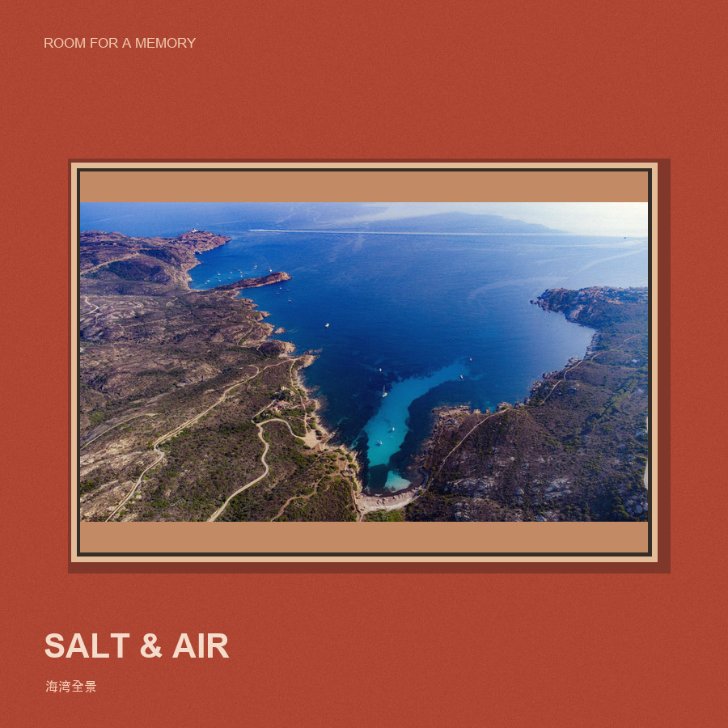
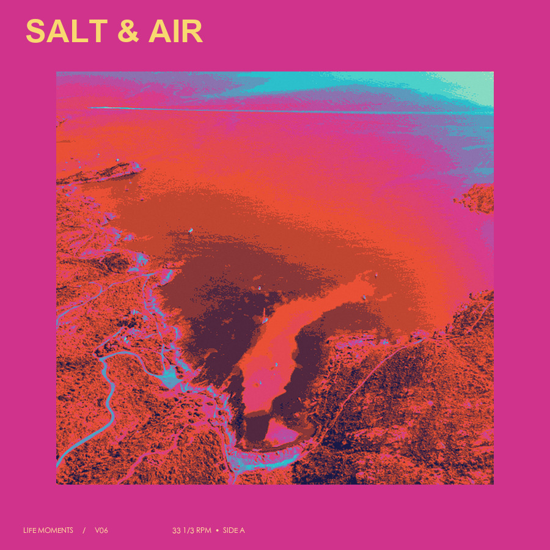
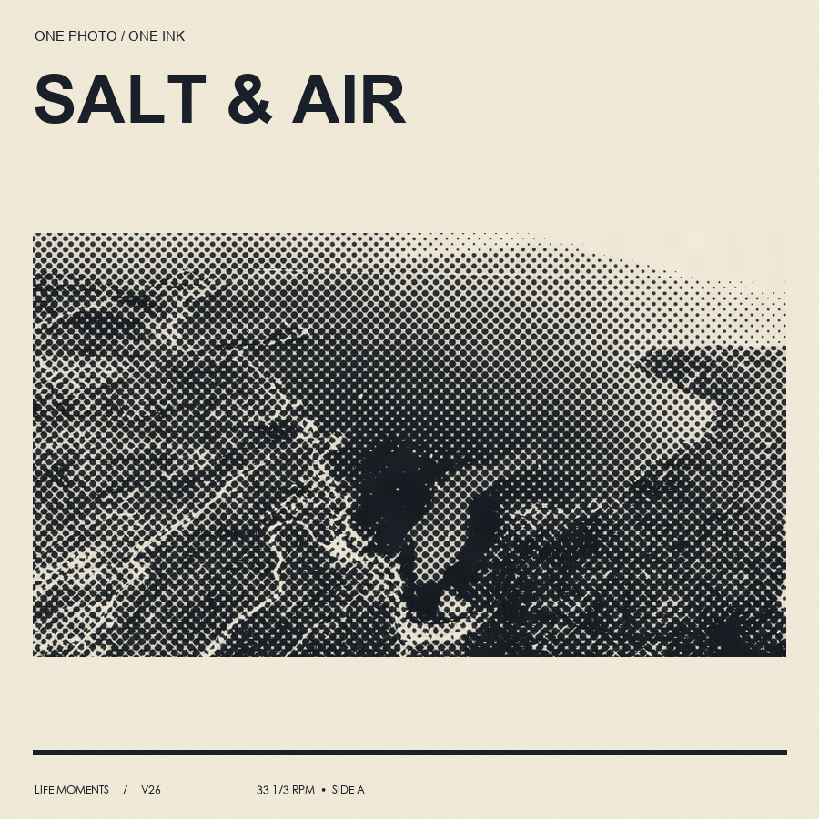

# 共创式视觉情绪板 · Visual Direction Moodboard

**中文** | [English](README.en.md)

## 减少 AI 味，让设计不再千篇一律

AI 生成的设计总是似曾相识？用真实设计参考和你的判断，找到更有个性的视觉方向。

这个 **Moodboard Skill** 帮你搜集真实作品、浏览选图、讨论补搜，再整理情绪板。适合品牌视觉、UI 设计、封面设计和创意研究。

**关键词 → 真实参考图库 → 你选图、给反馈 → 深入研究或试做 → 情绪板与设计依据。**

[下载安装](#下载安装) · [看真实案例](examples/photo-to-cover.md) · [参与贡献](#参与贡献)

## 一句话开始

安装后，把项目和感觉告诉 Agent：

```text
使用 visual-direction-moodboard。我的咖啡品牌想要温暖、粗粝、手工的感觉，
但不想做成千篇一律的 AI 设计。先找真实设计参考，给我看图、选图，
我们讨论后再整理情绪板。
```

已有关键词、参考图或具体设计问题，都可以直接开始。Codex 中也可用 `$visual-direction-moodboard` 调用。

## 怎么用、得到什么

| 你做什么 | Agent 做什么 | 留下什么 |
| --- | --- | --- |
| 给项目、关键词或喜欢的作品 | 搜集真实设计，展示不同解释 | 带编号、关键词和来源的候选图库 |
| 看图，选喜欢的或指出不对的地方 | 讨论字图关系、配色、材质、裁切，按反馈补搜 | 选择与讨论记录，其他候选仍可回看 |
| 需要时要求少量试做 | 用你的素材比较方案，再看不同素材是否适用 | 原图与试样对照，记录适用范围 |
| 判断清楚后整理 | 提炼值得保留的设计决定 | 情绪板或参考页，按需交接视觉规则 |

不需要先解释清楚所有感觉。可以只说：“I012 的字图比例喜欢，但配色不对；沿 I018 的纸感继续找。”喜欢一张参考，也不等于接受它的全部特征。

HTML 图库的选择应能保存和导出。Agent 需读到反馈才会继续；工具无法读取时，把导出结果贴回对话即可。

## 真实案例：从唱片参考到照片试样

一次实际探索收集了 **37 个项目、68 张参考图**。用户选出 **19 张喜欢的作品**，再提出“这些效果适不适合不同照片”的问题，推动研究进入试做。

下面是同一张海湾照片的三个实际探索结果：

| 图窗与留白 | 电色分离 | 单墨粗网 |
| --- | --- | --- |
|  |  |  |

这组对照改变了处理和版式，用于讨论完整表达；不是用户选定的最终品牌方案。照片：Tom / Pexels，[来源与许可](examples/ASSET-CREDITS.md)。

**[查看完整过程：找参考 → 选图 → 同图多方案 → 同方案多素材 → 反馈修订](examples/photo-to-cover.md)**

<details>
<summary>再看一个教学示例：咖啡品牌怎样从词走到图</summary>

这是说明用的假设场景，编号和反馈均为示例。

1. “温暖、粗粝、手工” → 沿纸张、印刷、字体和空间搜集不同解释。
2. “I012 的字图比例好，但不喜欢咖啡色” → 分开记录版式和配色偏好，补搜。
3. “同一张照片试两种字图关系” → 保持素材与文案一致，比较版式。
4. “保留大字和粗纸感，颜色更清爽” → 整理已有依据，保留配色的待验证部分。

</details>

## 下载安装

在 [Releases](https://github.com/buttonsprite/visual-direction-moodboard/releases/tag/v0.1.0) 下载对应 ZIP。

- **Codex / 标准 Skill**：下载 `visual-direction-moodboard-v0.1.0.zip`，解压到 Skills 目录。Codex 默认是 `~/.codex/skills/`；设置了 `CODEX_HOME` 时使用其下的 `skills/`。文件夹内应直接包含 `SKILL.md`、`references/` 和 `agents/`。已有同名版本先备份，再替换并重新加载技能。
- **WorkBuddy**：下载 `visual-direction-moodboard-workbuddy-v0.1.0.zip`，用于 ZIP 导入或开放平台提交，已按 [官方规范](https://open.workbuddy.cn/docs/skill) 适配元数据。平台解析、运行和上架状态以 WorkBuddy 为准。

## 使用前了解

这是给 AI Agent 的工作流程 Skill。图库与试样由 Agent 按项目制作，示例中的图库应用和模板引擎不在安装包中。

Agent 需要搜索、浏览和看图能力；制作 HTML 或试样还需要相应文件与图像工具。没有绑定特定模型或付费服务。v0.1.0 为公开试用版；跨 Agent 表现和 WorkBuddy 运行仍需实际验证。情绪板帮助形成方向，完整品牌系统需要后续设计。

## 参与贡献

欢迎一起改进，非开发者也可以参与：

- [提 Issue](https://github.com/buttonsprite/visual-direction-moodboard/issues)：分享使用环境、需求、实际结果和建议。
- [提 Pull Request](https://github.com/buttonsprite/visual-direction-moodboard/pulls)：Fork 后修改流程、文档或平台适配，说明改了什么、验证了什么，由维护者审核合入 `main`。
- **补充案例**：展示想法、选图、反馈和调整过程，区分真实结果与教学示例，保留图片来源与许可。

较大的流程改动先开 Issue 讨论。保留候选可回看、用户选择与 Agent 判断分开、按反馈继续研究的原则。公开仓库不等于所有人都有主分支写入权限。

## 文档与许可

[Skill 指令](SKILL.md) · [标准流程](references/standard-workflow.md) · [记录模板](references/deliverable-templates.md)

文档与配置采用 [MIT](LICENSE.txt)。示例照片及衍生图适用各自的 [图片许可](examples/ASSET-CREDITS.md)，不包含在 MIT 授权中。

相关方向：情绪板 / Moodboard · 视觉方向 / Visual Direction · 设计参考 / Design References · 品牌视觉 / Brand Identity · 艺术指导 / Art Direction · AI Design · Agent Skills
