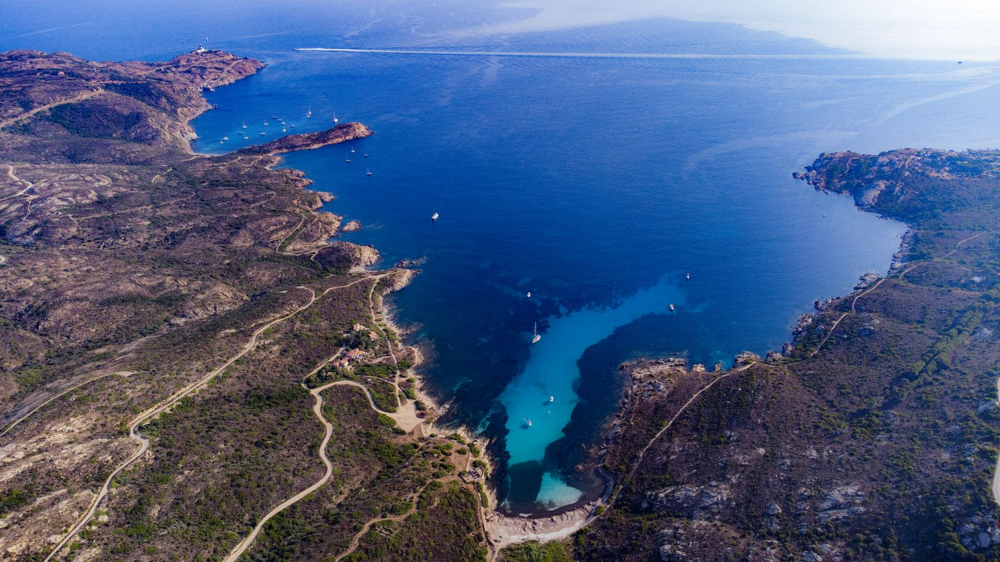
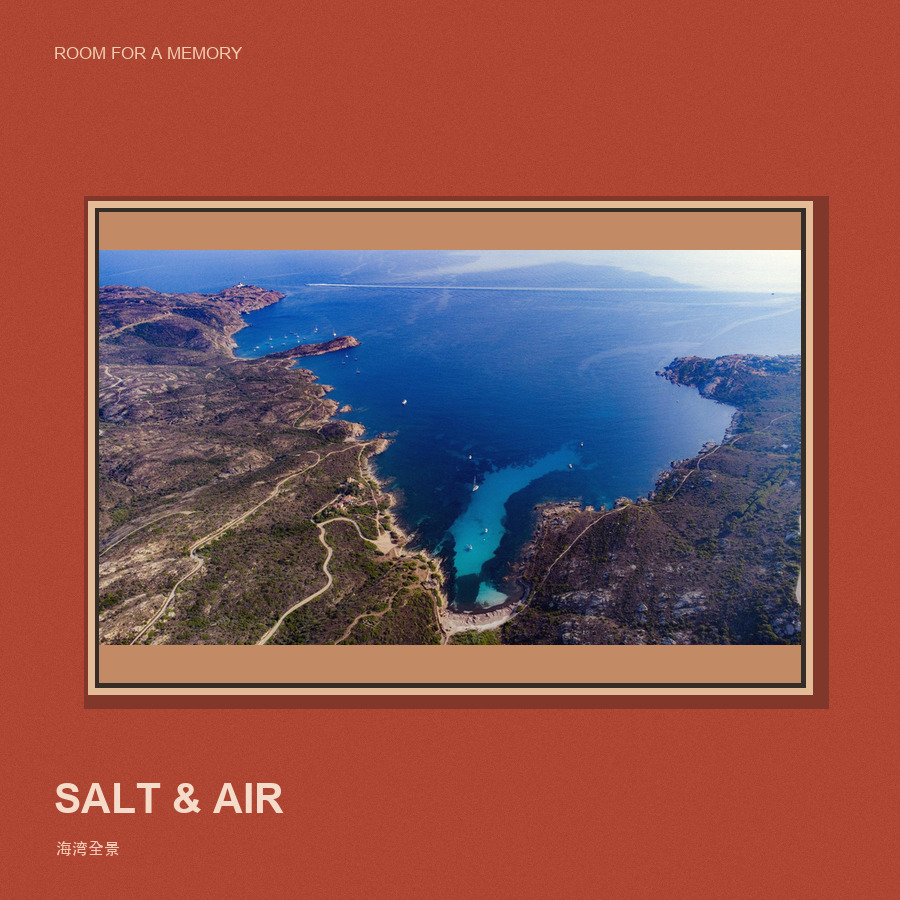
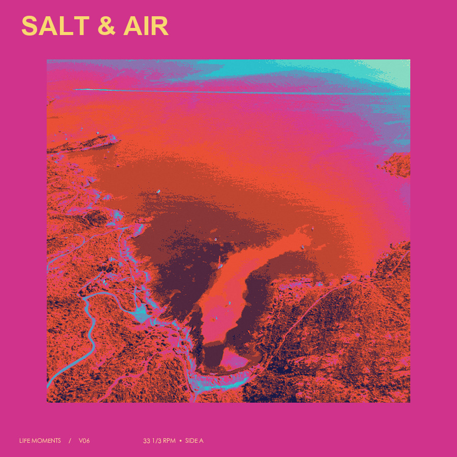
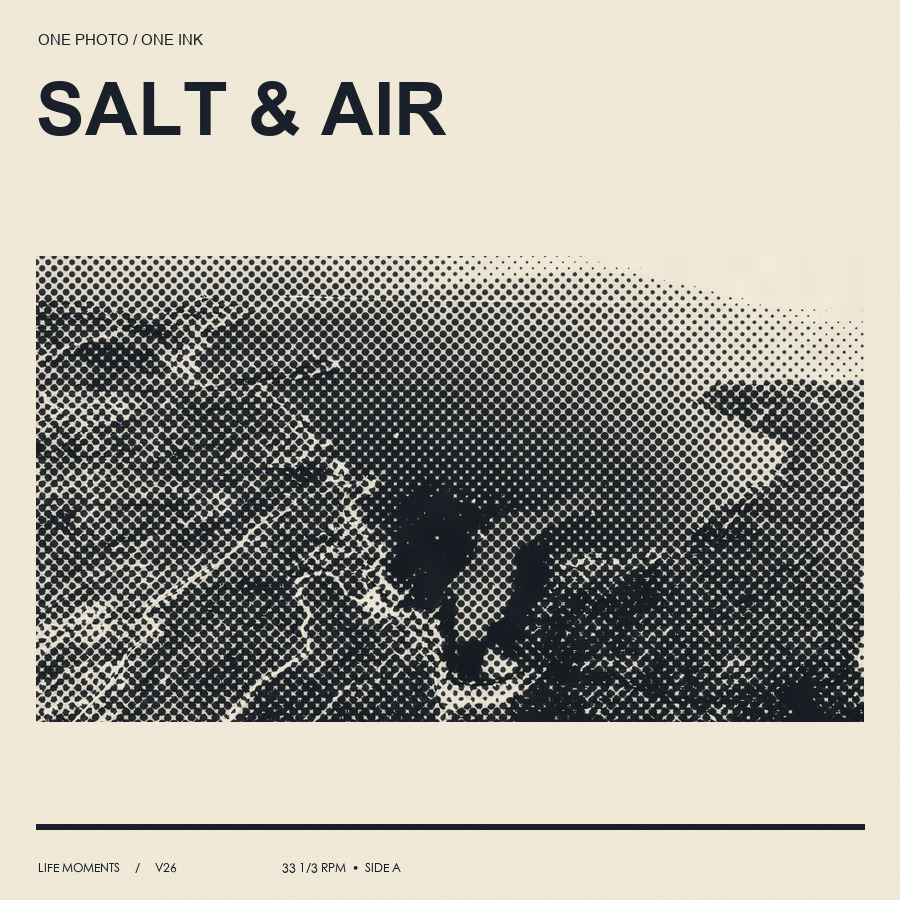
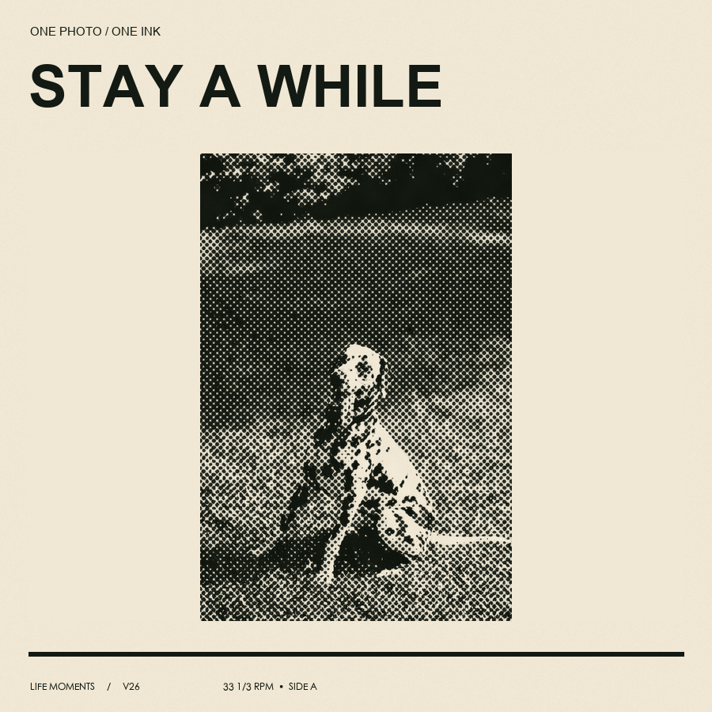
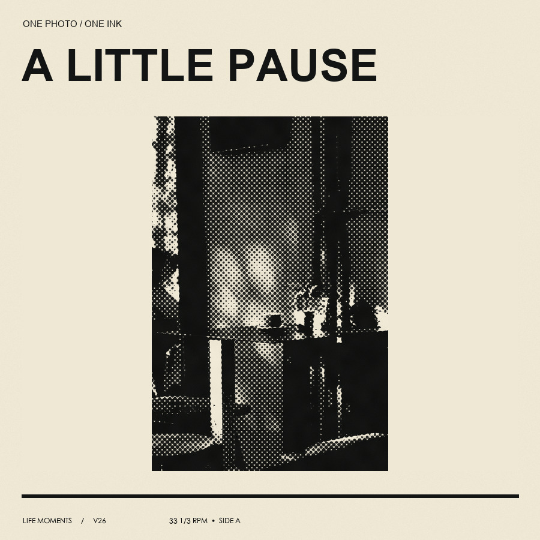

# 真实案例：从唱片参考到照片封面试样

[← 返回使用介绍](../README.md)

这个案例来自一次实际的照片封面探索。目标是研究怎样把不同题材的照片转化为有唱片感的画面。下面整理已发生的研究、选图与试做过程，展示图取自当时产物；它不是安装后自动生成的固定演示，也不是最终上线效果。

## 1. 把宽泛的感觉变成可浏览的研究

用户已对封面表达有兴趣，因此研究沿着“图像具体如何被处理”展开。实际收集了 **37 个项目、68 张图**，按以下线索组织：

| 研究词 | 看图时想分清什么 |
| --- | --- |
| 轻调色、影调、夜色、低饱和 | 气氛来自拍摄光线，还是后期调色？ |
| 黑白、单色、duotone | 哪些明暗和层次被保留下来？ |
| 负片、分离色、反转 | 强配色如何改变主体辨识度？ |
| 颗粒、网点、复印、纸纹 | 是图像本身的结构，还是封套表面的质感？ |
| 模糊、重影、流光、反馈 | 动感来自拍摄还是后期处理？ |
| 图窗、留白、裁切、遮罩 | 照片在画面里占多少面积、哪些部分被保留？ |
| 叠印、几何、图形、合成 | 效果能否从单张图得到，还是依赖多素材？ |
| 切片、重复、拼贴、网格 | 单图重复与多张连续影像会产生什么差异？ |

这些分类让用户有地方开始看，也允许跨组选择。它们并不预先代表八套品牌方案。

候选图库为作品保留编号、关键词、来源和系列图，用户可以回看其他候选。部分实际进入讨论的参考如下；点击链接查看原作品：

| 参考编号 | 作品 | 后续研究关注点（Agent 的转化思路） |
| --- | --- | --- |
| I143 | [A LA SALA](https://khruangbin.bandcamp.com/album/a-la-sala) | 图窗、留白与照片面积 |
| I145 | [Technique](https://www.factoryrecords.org/factory-records/fact-275-new-order-technique.php) | 强配色与非自然色映射 |
| I137 | [War Garden](https://coldbeatsf.bandcamp.com/album/war-garden) | 颗粒、网点与印刷感 |

以上是对参考的研究与转化，不代表已确认原作者的制作工艺。试样未使用这些封面中的图像像素。

## 2. 用户选图，问题随之变得具体

用户在图库中选出了 **19 张“喜欢”**，没有逐件填写短评。随后提出了实际问题：这些效果能否应用到各种照片上，哪些可以通过常规图像处理实现？

此时形成的是参考偏好。Agent 保留了全部选择，并把原作者的工艺、可尝试的实现方法和素材适用范围分开分析。用户无需先解释清楚所有喜欢的理由，就可以在下一步看试样继续判断。

## 3. 同一输入，比较不同表达

用户进一步要求找原图、试出效果并建立对比。首轮实际做了 **19 个模板 × 10 组输入**：8 张来源照片，加超宽与低清暗光两个压力样本，共 190 张封面与对应的处理图。

这是该项目当时明确要求的实验规模。一般使用可以先做少量足以看清差异的试样。

下面选用同一张海湾照片，展示首轮与后续扩展中的三个实际结果。

### 本项目的输入照片



摄影：Tom / Pexels。[原始来源](https://www.pexels.com/photo/aerial-photography-of-sea-and-coastline-13793448/)。这里的“输入”指尚未套用本项目效果的素材站照片，不代表未经摄影者后期的 RAW。

### 三种实际试样

| V01 · 赤陶之窗 | V06 · 电色分离 | V26 · 单墨粗网 |
| --- | --- | --- |
|  |  |  |
| 暖色处理、照片窗、留白 | 亮度量化、非单调色彩映射 | 从输入提取墨色、粗颗粒网点、纸面 |

观察这组三图，可以讨论照片占比、强配色和颗粒感怎样改变表达。它们同时改变了处理与布局，属于完整方案的对照；要判断单独的处理效果，应进一步并排看“原图 → 处理图”，保持其他条件一致。

V01、V06 来自首轮，V26 来自后续丝网印刷风格研究。本页将它们并列用于解释比较方式，未把三者写成同一轮获选方案。

## 4. 同一方法，再看不同素材

用户继续要求普通题材与更多印刷风格的尝试。下面是“单墨粗网”方法在三个不同输入上的实际结果：

| 海湾全景 | 草地上的狗 | 咖啡角落 |
| --- | --- | --- |
|  |  |  |

方法相同，墨色依据输入提取，画幅与版式也随输入适配。Agent 从这些样本中可以观察到：海湾的大面积层次、宠物轮廓、室内明暗，在粗网点下呈现的辨识度不同；颗粒增强时，细节也可能减少。这些是待用户判断的取舍。

照片分别来自 Tom、Bethany Ferr、Nazlı Gaylan Azili / Pexels，详见 [图片来源与许可](ASSET-CREDITS.md)。

## 5. 反馈作用在下一轮，而不止是选一个结果

实际试用中，用户指出了几处问题：部分网点效果不理想，某种效果只处理画面中间显得奇怪，电色方向希望继续看变体。

后续因此补充普通日常照片，并分别尝试更连续的网点、整幅处理和电色变体。旧方案与旧反馈保留，新试样独立记录。用户喜欢某个参考，不等于已经接受试样的配色、裁切或主体遮挡。

这一段流程形成了三个不同层面的产出：

- **参考研究**：哪些真实作品、哪些视觉特征值得继续看。
- **素材上的试验**：方法如何改变自己的图像，哪些输入会暴露问题。
- **可继续讨论的判断**：保留什么、调整什么、哪些还没选定。

本案例公开的是研究与探索试样，没有把这些过程写成已完成的品牌定稿。需要最终情绪板时，可以再把已明确的参考、选中试样和设计决定整理到一起。

## 你可以怎样复用这个过程

```text
使用 visual-direction-moodboard。
我想把自己的照片做成有唱片感的封面，已经有几张喜欢的参考。
请先研究相关作品，按图像处理与字图关系给我一个可回看的候选图库。
等我选图后，先拿少量照片试做，并排展示原图、处理结果和构图。
我想看完再讨论哪些方法值得继续，不需要一开始就定完整品牌方向。
```

本仓库提供这一工作流程，案例里的图库界面、处理代码和模板库属于项目中额外制作的产物，不随 Skill 安装包分发。试样使用常规图像处理与程序排版制作；这些数字近似不等于还原原作工艺，也不能证明对任意照片都有效。
